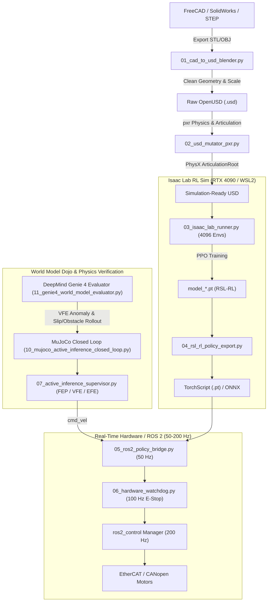

# Autonomous Robotics Pipeline: CAD -> OpenUSD -> Isaac Lab -> ROS 2 -> Active Inference

Distilled from the fleet robotics research session (October 24, 2026).
Engineered for **RTX 4090 / WSL2 Linux** running NVIDIA Isaac Lab + ROS 2 Humble/Jazzy.

---

## 🏗️ Architecture Stack



---

## 📁 Pipeline Components

| Script / Config | Purpose |
|---|---|
| [`01_cad_to_usd_blender.py`](file:///D:/Dev/repos/isaac-mcp/pipeline/01_cad_to_usd_blender.py) | Headless Blender script to import CAD (STL/OBJ/PLY), fix normals, rescale mm to meters, and export OpenUSD. |
| [`02_usd_mutator_pxr.py`](file:///D:/Dev/repos/isaac-mcp/pipeline/02_usd_mutator_pxr.py) | Pixar USD (`pxr`) mutator attaching `UsdPhysics.ArticulationRootAPI`, collision meshes, mass tensors, and materials. |
| [`03_isaac_lab_runner.py`](file:///D:/Dev/repos/isaac-mcp/pipeline/03_isaac_lab_runner.py) | Isaac Lab launcher with 4096 parallel environments, observation/reward shaping, and RSL-RL PPO configuration. |
| [`04_rsl_rl_policy_export.py`](file:///D:/Dev/repos/isaac-mcp/pipeline/04_rsl_rl_policy_export.py) | Checkpoint exporter freezing actor weights + observation normalization into TorchScript (`.pt`) and ONNX. |
| [`05_ros2_policy_bridge.py`](file:///D:/Dev/repos/isaac-mcp/pipeline/05_ros2_policy_bridge.py) | ROS 2 Python node running policy inference at 50 Hz, bridging `/cmd_vel` and sensor streams to `ros2_control`. |
| [`06_hardware_watchdog.py`](file:///D:/Dev/repos/isaac-mcp/pipeline/06_hardware_watchdog.py) | 100 Hz safety daemon: heartbeat timeout, joint limit clamping, slew rate smoothing, and latching hardware E-stop. |
| [`07_active_inference_supervisor.py`](file:///D:/Dev/repos/isaac-mcp/pipeline/07_active_inference_supervisor.py) | Karl Friston Active Inference agent: minimizes Variational Free Energy (perception) and Expected Free Energy (action planning). |
| [`08_nori_a3_active_inference_arm.py`](file:///D:/Dev/repos/isaac-mcp/pipeline/08_nori_a3_active_inference_arm.py) | 7-DoF Active Inference Arm Controller for `norirobotics a3`: singularity-free compliant reaching via VFE gradient descent. |
| [`09_saschibot_active_inference_arm_lift.py`](file:///D:/Dev/repos/isaac-mcp/pipeline/09_saschibot_active_inference_arm_lift.py) | Whole-body Active Inference controller for `saschibot`: harmonizes prismatic lift (m) and revolute arm (rad) degrees of freedom. |
| [`10_mujoco_active_inference_closed_loop.py`](file:///D:/Dev/repos/isaac-mcp/pipeline/10_mujoco_active_inference_closed_loop.py) | Closed-loop MuJoCo 3.x physics verification of Laplace Active Inference whole-body bimanual + telescopic column control on `saschirob.xml`. |
| [`11_genie4_world_model_evaluator.py`](file:///D:/Dev/repos/isaac-mcp/pipeline/11_genie4_world_model_evaluator.py) | Interactive Google DeepMind Genie 4 World Model Evaluator: prompt-steered sensory rollouts, dynamic domain randomization, and physical plausibility gating. |
| [`12_cosmos_world_foundation_runner.py`](file:///D:/Dev/repos/isaac-mcp/pipeline/12_cosmos_world_foundation_runner.py) | NVIDIA Cosmos World Foundation Model (WFM) Runner: single GPU time-sliced or dual-GPU (RTX 4090 + 16GB eGPU) concurrent action-conditioned rollouts. |
| [`config/ros2_control.urdf.xacro`](file:///D:/Dev/repos/isaac-mcp/pipeline/config/ros2_control.urdf.xacro) | Modular `ros2_control` hardware interface configuration for Wheeled Telescoping Bimanual (`saschirob` / `Nori A3`) Feetech STS bus + diff-drive + IMU. |
| [`config/ros2_controllers.yaml`](file:///D:/Dev/repos/isaac-mcp/pipeline/config/ros2_controllers.yaml) | 200 Hz Controller Manager configuration (`diff_drive_controller`, `lift_controller`, `left_arm_controller`, `right_arm_controller`, grippers). |

---

## ⚡ Quickstart Guide (WSL2 / Linux)

### 1. Convert CAD to OpenUSD
```bash
blender --background --python 01_cad_to_usd_blender.py -- \
  --input ../assets/robot.stl \
  --output ./usd/robot_base.usd \
  --scale 0.001
```

### 2. Inject Physics & Articulation
```bash
python 02_usd_mutator_pxr.py \
  --input ./usd/robot_base.usd \
  --output ./usd/robot_sim_ready.usd \
  --root /World/Robot
```

### 3. Launch Isaac Lab RL Training (RTX 4090)
```bash
./isaaclab.sh -p 03_isaac_lab_runner.py --num_envs 4096 --headless
```

### 4. Export Policy to TorchScript
```bash
python 04_rsl_rl_policy_export.py \
  --checkpoint ./logs/model_1500.pt \
  --output ./exported/policy.pt
```

### 5. Evaluate in DeepMind Genie 4 World Model Dojo
```bash
py 11_genie4_world_model_evaluator.py \
  --prompt "Wet tiled corridor with an unexpected moving cart" \
  --horizon 32 \
  --dt 0.02
```

### 6. Run Local NVIDIA Cosmos WFM (Single or Dual-GPU)
```bash
# Dual-GPU concurrent (GPU 0 = 4090 24GB Physics, GPU 1 = 16GB eGPU Cosmos WFM)
py 12_cosmos_world_foundation_runner.py \
  --prompt "Medieval stone courtyard with torchlit stone paving" \
  --gpu-physics 0 \
  --gpu-wfm 1 \
  --quant fp8
```

### 7. Launch ROS 2 Real-Time Control & Safety Watchdog
```bash
# Terminal 1: Safety Watchdog
ros2 run fleet_robotics 06_hardware_watchdog

# Terminal 2: Policy Bridge Node
ros2 run fleet_robotics 05_ros2_policy_bridge --ros-args -p model_path:=./exported/policy.pt

# Terminal 3: Cognitive Active Inference Supervisor
python 07_active_inference_supervisor.py
```
